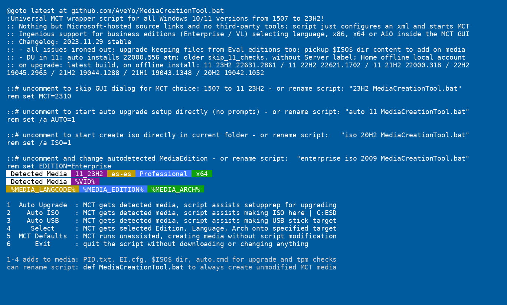

Non ye namás un script wrapper universal de MediaCreationTool con un soporte ingeniosu pa les ediciones empresariales,  
  
¡Tamién ye una ferramienta potente pero simple d'automatización del despliegue de Windows 10 / 11!  
*Si hasta agora nun consigui executar el script, esta última versión va funcionar*

**Asturianu** · [English](README.md) · [Español](README.es.md) · [Technical details](docs/TECHNICAL.en.md) · [Detalles téunicos](docs/TECHNICAL.es.md)  

Preaxustes  
----------  
1 ***Auto Upgrade*** colos medios detectaos, el script asiste a setupprep pa actualizar directamente
> _- pue caltener ficherus y aplicaciones en más escenarios nos que'l sistema y la edición de destino nun coinciden_
> _- pue camudar la edición detectada añadiendo EditionID al nome del script_
> _- pue diagnosticar fallos d'actualización añadiendo `no_update` al nome del script_
> _- por defecto usa la 11, asina que pasa tamién la versión pa la 10: `auto 21H2 MediaCreationTool.bat`_

2 ***Auto ISO*** colos medios detectaos na carpeta actual _(o C:\ESD si s'executa dende'l zip)_
> _- pue anular los medios detectaos añadiendo edición / llingua / arquiteutura al nome del script_
> _- exemplu: `21H1 Education en-US x86 iso MediaCreationTool.bat`_

3 ***Auto USB*** colos medios detectaos nel destino USB indicáu
> _- por seguridá de datos, nun ta totalmente automatizáu - tienes de seleccionar la unidá USB manualmente na GUI_

4 ***Select*** cola Edición, Llingua y Arquiteutura (x86,x64,dambes) escoyíes pol usuariu - nel destino indicáu
> _- eleición implícita, inclúi los ficherus de sustitución de setup (desactívense añadiendo `def` al nome del script)_

5 ***MCT Defaults*** execútase ensin asistencia, creando medios ensin modificar el script
> _- nun añade ficherus, el script pasa `products.xml` a MCT y sálse ensin tocar los medios_

6 ***Exit*** sale del script ensin descargar nin camudar nada



Los preaxustes 1-4 modifiquen los medios creaos de les maneres siguientes:
> _- escribe `auto.cmd` pa executar so demanda la actualización automática con cambiu d'edición y saltu de tpm_
> _- escribe'l conteníu de la carpeta `$ISO$` (si esiste) na raíz de los medios_
> _si enantes usasti conteníu $OEM$, agora tienes de ponelo en `$ISO$\sources\$OEM$\`_
> _- escribe `sources\PID.txt` pa preseleccionar la edición al arrancar los medios o dientro de Windows (si ta configuráu)_
> _- escribe `sources\EI.cfg` pa evitar el pidíu de clave de producto nos medios de consumidor de Windows 11 (namás 11)_
> _- escribe `AutoUnattend.xml` en boot.wim pa habilitar cuenta llocal en Windows 11 Home (namás 11)_
> _- parchea `winsetup.dll` en boot.wim pa quitar les comprobaciones de Windows 11 al arrancar dende los medios (namás 11)_
> _- pue desactivase añadiendo `def` al nome del script pa llograr medios MCT por defecto, ensin tocar_

Linux  
-----  
`MediaCreationTool.sh` ye'l mesmu wrapper pa bash - los mesmos preaxustes, les mesmes fontes agospiaes por Microsoft, ensin ferramientes de terceros:

```
./MediaCreationTool.sh                                  # interactive menu, 6 = Exit  
./MediaCreationTool.sh iso 22H2                         # download the iso / esd in the current folder  
./MediaCreationTool.sh auto 11_23H2 Professional en-US  # build the upgrade kit  
./MediaCreationTool.sh usb official11                   # download the image and write it to usb  
./MediaCreationTool.sh --dry-run iso 1909               # resolve the link and check it is alive  
```

> _- rique `curl`, más `python3` y `cabextract` pal catálogu, `xorriso` pa inyectar extras nuna iso, `lsblk` + `dd` pal USB_
> _- la descarga usa `aria2c` cuando ta disponible, dempués `curl` y dempués `wget`; les descargues parciales siguen d'onde diben_
> _- `official11` / `official10` usen l'api de descarga de software de Microsoft (el mesmu protocolu que Fido); si Microsoft refuga la petición dende la to IP, el script recurre al catálogu esd_
> _- el catálogu devuelve l'esd exactu que publica Microsoft (verificáu con sha1), l'api oficial devuelve la iso real (x64, arrancable)_
> _- `def` nun añade ficherus extra, `no_update` desactiva l'actualización dinámica - mesmu significáu que nel bat_
> _- `./MediaCreationTool.sh --help` llista toles versiones, ediciones, llingües y argumentos_

Despliegue simple  
-----------------  
**auto.cmd** ta detrás del preaxuste ***Auto Upgrade*** per mediu de la GUI
Pues executalo dafechu ensin asistencia renombrando'l script con `auto MediaCreationTool.bat`
Facilita actualizar calteniendo ficherus y aplicaciones cuando la edición del sistema nun coincide colos medios
Tamién debería permitir actualizar dende Ultimate, PosReady, Embedded, LTSC o Enterprise Eval

El script xeneráu añádese a los medios creaos pa que puedas executalo de nuevo en cualquier momentu
Ye abondo xenéricu - detecta les ediciones disponibles en install.esd, escueyi un índiz afayadizu,
dempués pon EditionID nel rexistru pa que coincida; ¡pue inclusive forzar otra edición, calteniendo ficherus y aplicaciones!
Na 11, va intentar saltase les comprobaciones de setup (pues desactivar esti comportamientu con una variable del script)
A lo último, define les opciones de setup encamentaes con menos problemes nes actualizaciones

> Digaos que'l sistema actual ye Enterprise LTSC 2019, y que usas los medios empresariales pa actualizar:
> **auto.cmd** escueyi l'índiz Enterprise y axusta EditionID a Enterprise nel rexistru (guardáu como EditionID_undo)
> Quiciabes tamién quieras camudar d'edición,
> ex. renombrando'l script a `ProfessionalWorkstation MediaCreationTool.bat`:
> **auto.cmd** escueyi l'índiz Professional y pon EditionID a ProfessionalWorkstation nel rexistru.
>   
> Digaos que'l sistema ye Windows 7 Ultimate o PosReady, y que usas los medios de consumidor pa actualizar:
> **auto.cmd** escueyi l'índiz Professional y pon EditionID a Professional o Enterprise, respeutivamente.
> En toos los casos, el script intenta escoyer un índiz esistente, o unu compatible pa caltener ficherus y aplicaciones na actualización.
>   
> Digaos que tienes una docena de PCs esparcíos por versiones: 7, 8.1, 10 y ediciones: Ultimate, Home, Enterprise LTSB..
> Si precisas actualizar toos a la última versión de la 10 y usar namás Pro, pues renombrar el script asina:
> `auto 21H2 Pro MediaCreationTool.bat`
>
> Tamién puedes añadir una clave de producto VL / MAK / retail de la mesma manera pa ocuparte de les diferencies de llicencia.
> El script tamién recueye cualquier carpeta `$ISO$` que haya nel llugar actual - pa marca $OEM$, configuración, axustes etc.

Historial de cambeos  
--------------------  
_Yá nun fai falta facer clic derechu y executar como alministrador, el script va pidilo él mesmu. Guardar los ficherus Raw directamente yá nun rompe los finales de llinia_
_¡Lo fiximos! Rompimos [l'anterior gist](https://git.io/MediaCreationTool.bat) ;) Asina que esta ye la nueva casa. **¡Gracies a toos!**_

[aldericar en MDL](https://forums.mydigitallife.net/threads/universal-mediacreationtool-wrapper-script-create-windows-11-media-with-automatic-bypass.84168/)

```
2018.10.10: reinstated 1809 [RS5]! using native xml patching for products.xml; fixed syntax bug with exit/b
2018.10.12: added data loss warning for RS5
2018.11.13: RS5 is officially back! + greatly improved choices dialog - feel free to use the small snippet in your own scripts
2019.05.22: 1903 [19H1]
2019.07.11: 1903 __release_svc_refresh__ and enable DynamicUpdate by default to grab latest CU
2019.09.29: UPDATED 19H1 build 18362.356 ; RS5 build 17763.379 and show build number
            added LATEST MCT choice to dinamically download the current version (all others have hard-coded links)
2019.11.16: 19H2 18363.418 as default choice (updated hard-coded links)
2020.02.29: 19H2 18363.592
2020.05.28: 2004 19041.264 first release
2020.10.29: 20H2 and aniversary script refactoring to support all MCT versions from 1507 to 20H2!!!
2020.10.30: hotfix utf-8, enterprise on 1909+
2020.11.01: fix remove unsupported options in older versions code breaking when path has spaces.. pff
2020.11.14: generate latest links for 1909,2004; all xml editing now in one go; resolved known cannot run script issues
2020.11.15: one-time clear of cached MCT, as script generates proper 1.0 catalog for 1507,1511,1703 since last update
            fixed compatibility with naked windows 7 powershell 2.0 / IPv6 / optional import $OEM$ / 1803+ business typo
            updated executables links for 1903 and 2004
2020.11.17: parse first commandline parameter as version, example: MediaCreationTool.bat 1909
2020.12.01: attempt to fix reported issues with 1703; no other changes (skipping 19042.630 leaked esd because it is broken)
2020.12.11: 20H2 19042.631; fixed pesky 1703 decryption bug on dual x86 + x64; improved cleanup; label includes version
2021.03.20: pre-release 21H1; optional auto upgrade or create media presets importing $OEM$ folder and key as PID.txt
2021.05.23: 21H1 release; enhanced script name args parsing, upgrade from embedded, auto.cmd / PID.txt / $OEM$ import
2021.06.06: create iso directly; enhanced dialogs; args from script name or commandline; refactoring is complete!
2021.08.04: done fiddling
2021.09.03: 21H2, both 10 and 11 [unreleased]
2021.09.25: Windows 11
            with Skip TPM Check on media boot as well as on dynamic update (standalone toggle script available)
            final touches for improved script reliability; enhanced auto upgrade preset; win 7 powershell 2.0 compatible
2021.09.30: fix Auto Setup preset not launching.. automatically
2021.10.04: fix for long standing tr localization quirks; Skip TPM Check v2 (ifeo-based instead of wmi)
2021.10.05: 11 22000.194 Release (rofl W11 MCT has limited capabilities, so still using 21H1 MCT because it works fine)
2021.10.09: outstanding refactoring around Windows 11 MCT; minimize while waiting MCT; unified 7 - 11 appearence
2021.10.20: create generic iso if no edition arg; use Downloads folder; no 11 setup checks on boot in VirtualBox; fixes #2
2021.10.23: 11 22000.258
            more intuitive presets; 11 setup override via AutoUnattend.xml or via boot.wim (for VirtualBox 5.x) with FIX arg
            only reliable ui automation; enhanced script output
2021.11.03: multiple download methods; improved automation; improved auto.cmd; moved autounattend.xml to boot.wim
            revising 11 setup bypass (wip) - not being content with any methods is the reason why I've not updated in a while
2021.11.09: skip windows 11 upgrade checks with setup.exe (not just auto.cmd); no server label; local account on 11 home
            auto.cmd has more fixes to keep files and apps on upgrade; reliable ui automation; alternative downloaders 
2021.11.15: 11 22000.318
            write output to script folder (or C:\ESD if run from zip); style: more consistent separation of arguments
            20H2 builds with esd size above 4GB that had to be reverted at 19042.631: en,de,es,pt,fr,it,jp,zh (MCT limits)
2021.11.16: 10 19044.1288 - official release of 10 21H2
            10 19043.1348 - newest 10 build - don't ask why ms is releasing these as such, it's not the first time
2021.12.07: skip windows 11 upgrade checks only via auto.cmd - just ignore server label, please
2021.12.15: fix regression with 1507-1709 not getting the correct fallback esd; fix dev '-noe' not autoclosing script
2021.12.22: improved auto.cmd handling of mismatched OS and target edition, obey 'def', 'auto' upgrades 7 to 10, not 11
2022.03.16: prevent launch errors when run from non-canonical paths; USBLayout progress; pickup $ISO$ dir to add on media
            DU in 11: auto installs 22000.556 atm; older skip_11_checks, without Server label; Home offline local account
2022.03.18: fix regression with Auto Upgrade; removed powershell -nop arg (issue #41); enhanced 11 AutoUnattend.xml
2022.03.20: stable - all issues ironed out; improved script ui; upgrade keeping files from Eval editions too
            last squash I promise ;)
```

ATENCIÓN, AVISU (12 d'ochobre de 2026): Microsoft va cortar a partir del 19 de xunu de 2027 l'accesu a Windows Update pa toos los equipos que tengan Windows 10 ensin ESU o inferior (el bloqueu anterior foi hasta Windows Vista/Server 2008 ensin R2); esto afecta lógicamente a les versiones de servidor (de Server 2008 R2 a Server 2019; a partir de Server 2022, el zarru de Windows Update nun los afecta). Ye por mor de la caducidá de los certificaos raíz del serviciu d'actualizaciones, que caduquen a partir d'esta data. Si quies echar una güeyada al enllaz oficial de la noticia de Microsoft, equí lo tienes (usa la traducción del navegador, ta n'inglés):

https://techcommunity.microsoft.com/blog/windows-itpro-blog/prepare-for-windows-update-certificate-rotation-in-2027/4562463

Recuerda que los certificaos raíz formen parte de la navegación per Internet; una de les carauterístiques del protocolu https ye que agora too lo que se tresfier al router ta cifráu (enantes nun yera asina). Sicasí, pa que programes como Wireshark, que s'usen pa analizar too lo que se tresfier nuna rede doméstica, nun tengan efeutu (nun se vea ningún datu sensible), los certificaos raíz tienen de funcionar y tar al día. Si nun funcionen, da un error de certificáu nel navegador y los programes que conecten a Internet dexarán de funcionar. Tienes que tener esto en cuenta cuando uses un Windows antiguu instaláu nel ordenador (per ciertu, el zarru de Windows Update tamién afecta a les máquines virtuales, esto ye, a los PCs arrancaos dentro d'un equipu físicu).

Cuando llegue la data de caducidá del certificáu raíz, ye posible que los Office instalaos en Windows ensin soporte den errores al comprobar actualizaciones (hasta 10 y Server 2019, que son veceru y servidor respeutivamente, puedes instalar el 2021-365, 7 y 8, hasta Office 2016); esto se resuelve desactivando les actualizaciones d'Office (cuando llegue la data de caducidá d'esos certificaos raíz).

Na ventana anterior (les actualizaciones automátiques impunxéronse a partir de Windows 2000) nun dio nengún tipu de fallu al arrancar el sistema operativu, namás al abrir la páxina de Microsoft Update o al iniciar Windows Update. (Yo pasé pela ventana anterior de zarru del update).

Nel casu de que seya Windows 10 con ESU, Windows 11 24H2, servidores LTSC de 2019 y 2016 y Server 2022, Microsoft punxo como métodu oficial pa resolver el problema la actualización: vas tener que actualizar el segundu martes de cada mes hasta la data del 19 de xunu de 2027, en qu'a yá... piano, piano (vas entender lo que te digo).

Nel casu de que te topes con esti tipu d'equipos, estes son les opciones que tienes:

-  mercar l'ESU (Windows 10) (nel casu de países de la Xunión Europea, nun tien ningún costu)
-  parchear el update pa acceder al ESU, l'únicu parche (y recomendable pa Windows 10) ye'l MAS (Microsoft Activation Script)
-  instalar un parche non oficial pa actualizar los certificaos raíz, que ye Legacy Update
-  nel casu de versiones compatibles (por agora nun ye obligatoriu dende 11 24H2; pa Windows 10 ensin ESU ye imprescindible a medies) aceptar les actualizaciones a versiones mayores de Windows per mediu d'actualización o faciendo una actualización dende los medios d'instalación de Windows.
-  caltener la instalación de Windows y facer un dual boot con Linux (nun ye aconseyable).
-  desinstalar Windows ya instalar Linux xunto con una máquina virtual de Windows (ellí se permite too, dende orixinales hasta modificaos)

Nel casu de que escojas la opción sensata (la postrera), recuerda que tienes de montar VMware o VirtualBox en Linux (instala Linux nel ordenador, lóxicamente) y la máquina virtual col Windows que escojas (ellí sí que puedes instalar Windows antiguos) de manera oficial hasta xunu de 2027; dempués nun va funcionar y namás vas poder instalar y actualizar esti tipu de PCs per métodos non oficiales.

Nel casu de que hayas perdíu l'empleu o'l cursu por haber dichu esta molestia, muncha suerte na busca d'empleu o na busca de cursu (esperu que lo atopes); con toles pistes que te digo yá verás cómo, seguro, al final atopes l'empleu o'l cursu soñáu.
