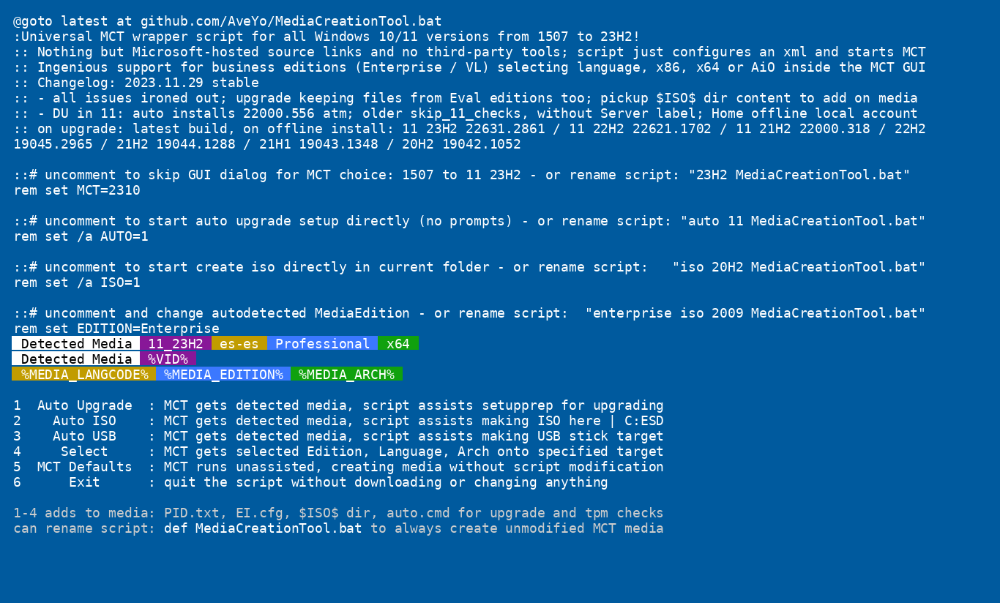

No es solo un wrapper de MediaCreationTool con un ingenioso soporte para ediciones empresariales,  
  
¡Es también una herramienta de despliegue de windows 10 / 11 potente pero sencilla!  
*Si hasta ahora no conseguiste ejecutar el script, esta última versión funcionará*  

[English](README.md) · **Español** · [Technical details](docs/TECHNICAL.en.md) · [Detalles técnicos](docs/TECHNICAL.es.md)  

Preajustes  
----------  
1 ***Auto Upgrade*** con los medios detectados, el script asiste a setupprep para actualizar directamente  
> _- conserva archivos y aplicaciones en más escenarios donde el sistema y la edición de destino no coinciden_  
> _- cambia la edición detectada añadiendo EditionID al nombre del script_  
> _- diagnostica fallos de actualización añadiendo `no_update` al nombre del script_  
> _- auto usa 11 por defecto, así que pasa también la versión para 10: `auto 21H2 MediaCreationTool.bat`_  

2 ***Auto ISO*** con los medios detectados en la carpeta actual _(o C:\ESD si se ejecuta desde el zip)_  
> _- puede anular los medios detectados añadiendo edición / idioma / arquitectura al nombre del script_  
> _- ejemplo: `21H1 Education en-US x86 iso MediaCreationTool.bat`_  

3 ***Auto USB*** con los medios detectados en el destino usb indicado  
> _- por seguridad no es totalmente automático - hay que seleccionar el disco usb manualmente en la GUI_  

4 ***Select*** con Edición, Idioma y Arquitectura elegidos por el usuario (x86, x64, ambos) - en el destino indicado  
> _- elección implícita, incluye los archivos de anulación de setup (se desactiva con `def` en el nombre del script)_  

5 ***MCT Defaults*** se ejecuta sin asistencia, creando medios sin modificar el script  
> _- no añade archivos, el script pasa `products.xml` a MCT y termina sin tocar los medios_  

6 ***Exit*** sale del script sin descargar ni cambiar nada  

  

Los preajustes 1-4 modifican los medios creados de la siguiente manera:  
> _- escribe `auto.cmd` para ejecutar bajo demanda la actualización automática con cambio de edición y omisión de tpm_  
> _- escribe el contenido de la carpeta `$ISO$` (si existe) en la raíz de los medios_  
> _si antes usaste contenido $OEM$, ahora hay que ponerlo en `$ISO$\sources\$OEM$\`_  
> _- escribe `sources\PID.txt` para preseleccionar la edición al arrancar los medios o dentro de windows (si está configurado)_  
> _- escribe `sources\EI.cfg` para evitar el aviso de clave de producto en los medios consumer de Windows 11 (solo 11)_  
> _- escribe `AutoUnattend.xml` en boot.wim para habilitar cuenta local en Windows 11 Home (solo 11)_  
> _- parchea `winsetup.dll` en boot.wim para quitar las comprobaciones de windows 11 al arrancar desde los medios (solo 11)_  
> _- se desactiva con `def` en el nombre del script para obtener medios MCT por defecto, sin tocar_  

Linux  
-----  
`MediaCreationTool.sh` es el mismo wrapper para bash - los mismos preajustes, las mismas fuentes alojadas por Microsoft, sin herramientas de terceros:  

```
./MediaCreationTool.sh                                  # menú interactivo, 6 = Exit  
./MediaCreationTool.sh iso 22H2                         # descarga el iso / esd en la carpeta actual  
./MediaCreationTool.sh auto 11_23H2 Professional en-US  # crea el kit de actualización  
./MediaCreationTool.sh usb official11                   # descarga la imagen y la escribe en usb  
./MediaCreationTool.sh --dry-run iso 1909               # solo resuelve el enlace y comprueba que vive  
```  

> _- requiere `curl`, más `python3` y `cabextract` para el catálogo, `xorriso` para inyectar extras en un iso, `lsblk` + `dd` para usb_  
> _- la descarga usa `aria2c` si está disponible, después `curl`, después `wget` - las descargas parciales se reanudan_  
> _- `official11` / `official10` usan la api software-download de microsoft (mismo protocolo que Fido); si microsoft rechaza la petición desde tu ip, el script vuelve al esd del catálogo_  
> _- el catálogo devuelve el esd exacto que publica microsoft (verificado por sha1), la api oficial devuelve el iso real (x64, arrancable)_  
> _- `def` no añade archivos extra, `no_update` desactiva la actualización dinámica - mismo significado que en el bat_  
> _- `./MediaCreationTool.sh --help` lista todas las versiones, ediciones, idiomas y argumentos_  

Despliegue sencillo  
-------------------   
**auto.cmd** está detrás del preajuste ***Auto Upgrade*** vía GUI  
Se puede ejecutar totalmente sin atender renombrando el script como `auto MediaCreationTool.bat`  
Facilita actualizar conservando archivos y aplicaciones cuando la edición del sistema no coincide con los medios  
Debería permitir actualizar desde Ultimate, PosReady, Embedded, LTSC o Enterprise Eval también  

El script generado se añade a los medios creados para poder ejecutarlo de nuevo en cualquier momento  
Es bastante genérico - detecta las ediciones disponibles en install.esd, elige un índice adecuado,  
y después ajusta EditionID en el registro para que coincida; ¡incluso puede forzar otra edición conservando archivos y aplicaciones!  
En 11 intenta saltarse las comprobaciones de setup (se puede desactivar con una variable del script)  
Por último, establece las opciones de setup recomendadas con la menor cantidad de problemas al actualizar  

> Supongamos que el sistema actual es Enterprise LTSC 2019 y usas los medios empresariales para actualizar:  
> **auto.cmd** selecciona el índice Enterprise y ajusta EditionID a Enterprise en el registro (respaldado como EditionID_undo)  
> Tal vez también quieras cambiar de edición,  
> p. ej. renombrando el script a  `ProfessionalWorkstation MediaCreationTool.bat`:  
> **auto.cmd** selecciona el índice Professional y fija EditionID a ProfessionalWorkstation en el registro.  
>   
> Supongamos que el sistema es Windows 7 Ultimate o PosReady y usas los medios consumer para actualizar:  
> **auto.cmd** selecciona el índice Professional y fija EditionID a Professional o Enterprise, respectivamente.  
> En todos los casos, el script intenta elegir un índice existente, si no uno compatible, para conservar archivos y aplicaciones.  
>   
> Supongamos que tienes una docena de equipos con versiones: 7, 8.1, 10 y ediciones: Ultimate, Home, Enterprise LTSB..  
> Si necesitas actualizarlos todos a la última versión de 10 y solo usas Pro, podrías renombrar el script así:  
> `auto 21H2 Pro MediaCreationTool.bat`  
>
> Se puede añadir una clave de producto VL / MAK / retail de la misma manera para resolver diferencias de licencia.  
> El script también recoge cualquier carpeta `$ISO$` en la ubicación actual - para marca $OEM$, configuración, ajustes, etc.  

Registro de cambios  
-------------------  
_No hace falta hacer clic derecho y Ejecutar como administrador, el script lo pide él mismo. Guardar directamente los archivos Raw ya no rompe los finales de línea_  
_¡Lo logramos! Rompimos [el gist anterior](https://git.io/MediaCreationTool.bat) ;-) Así que esta es la nueva casa. **¡Gracias a todos!**  

[comenta en MDL](https://forums.mydigitallife.net/threads/universal-mediacreationtool-wrapper-script-create-windows-11-media-with-automatic-bypass.84168/)  

```
2018.10.10: reinstated 1809 [RS5]! using native xml patching for products.xml; fixed syntax bug with exit/b
2018.10.12: added data loss warning for RS5
2018.11.13: RS5 is officially back! + greatly improved choices dialog - feel free to use the small snippet in your own scripts
2019.05.22: 1903 [19H1]
2019.07.11: 1903 __release_svc_refresh__ and enable DynamicUpdate by default to grab latest CU
2019.09.29: UPDATED 19H1 build 18362.356 ; RS5 build 17763.379 and show build number
            added LATEST MCT choice to dinamically download the current version (all others have hard-coded links)
2019.11.16: 19H2 18363.418 as default choice (updated hard-coded links)
2020.02.29: 19H2 18363.592
2020.05.28: 2004 19041.264 first release
2020.10.29: 20H2 and aniversary script refactoring to support all MCT versions from 1507 to 20H2!!!
2020.10.30: hotfix utf-8, enterprise on 1909+
2020.11.01: fix remove unsupported options in older versions code breaking when path has spaces.. pff
2020.11.14: generate latest links for 1909,2004; all xml editing now in one go; resolved known cannot run script issues
2020.11.15: one-time clear of cached MCT, as script generates proper 1.0 catalog for 1507,1511,1703 since last update
            fixed compatibility with naked windows 7 powershell 2.0 / IPv6 / optional import $OEM$ / 1803+ business typo
            updated executables links for 1903 and 2004
2020.11.17: parse first commandline parameter as version, example: MediaCreationTool.bat 1909
2020.12.01: attempt to fix reported issues with 1703; no other changes (skipping 19042.630 leaked esd because it is broken)
2020.12.11: 20H2 19042.631; fixed pesky 1703 decryption bug on dual x86 + x64; improved cleanup; label includes version
2021.03.20: pre-release 21H1; optional auto upgrade or create media presets importing $OEM$ folder and key as PID.txt
2021.05.23: 21H1 release; enhanced script name args parsing, upgrade from embedded, auto.cmd / PID.txt / $OEM$ import
2021.06.06: create iso directly; enhanced dialogs; args from script name or commandline; refactoring is complete!
2021.08.04: done fiddling
2021.09.03: 21H2, both 10 and 11 [unreleased]
2021.09.25: Windows 11
            with Skip TPM Check on media boot as well as on dynamic update (standalone toggle script available)
            final touches for improved script reliability; enhanced auto upgrade preset; win 7 powershell 2.0 compatible
2021.09.30: fix Auto Setup preset not launching.. automatically
2021.10.04: fix for long standing tr localization quirks; Skip TPM Check v2 (ifeo-based instead of wmi)
2021.10.05: 11 22000.194 Release (rofl W11 MCT has limited capabilities, so still using 21H1 MCT because it works fine)
2021.10.09: outstanding refactoring around Windows 11 MCT; minimize while waiting MCT; unified 7 - 11 appearence
2021.10.20: create generic iso if no edition arg; use Downloads folder; no 11 setup checks on boot in VirtualBox; fixes #2
2021.10.23: 11 22000.258
            more intuitive presets; 11 setup override via AutoUnattend.xml or via boot.wim (for VirtualBox 5.x) with FIX arg
            only reliable ui automation; enhanced script output
2021.11.03: multiple download methods; improved automation; improved auto.cmd; moved autounattend.xml to boot.wim
            revising 11 setup bypass (wip) - not being content with any methods is the reason why I've not updated in a while
2021.11.09: skip windows 11 upgrade checks with setup.exe (not just auto.cmd); no server label; local account on 11 home
            auto.cmd has more fixes to keep files and apps on upgrade; reliable ui automation; alternative downloaders 
2021.11.15: 11 22000.318
            write output to script folder (or C:\ESD if run from zip); style: more consistent separation of arguments
            20H2 builds with esd size above 4GB that had to be reverted at 19042.631: en,de,es,pt,fr,it,jp,zh (MCT limits)
2021.11.16: 10 19044.1288 - official release of 10 21H2
            10 19043.1348 - newest 10 build - don't ask why ms is releasing these as such, it's not the first time
2021.12.07: skip windows 11 upgrade checks only via auto.cmd - just ignore server label, please
2021.12.15: fix regression with 1507-1709 not getting the correct fallback esd; fix dev '-noe' not autoclosing script
2021.12.22: improved auto.cmd handling of mismatched OS and target edition, obey 'def', 'auto' upgrades 7 to 10, not 11
2022.03.16: prevent launch errors when run from non-canonical paths; USBLayout progress; pickup $ISO$ dir to add on media
            DU in 11: auto installs 22000.556 atm; older skip_11_checks, without Server label; Home offline local account
2022.03.18: fix regression with Auto Upgrade; removed powershell -nop arg (issue #41); enhanced 11 AutoUnattend.xml
2022.03.20: stable - all issues ironed out; improved script ui; upgrade keeping files from Eval editions too
            last squash I promise ;)
```

ATENCION, AVISO (12 de octubre de 2026): microsoft cortara el acceso a partir
del 19 de junio del 2027 el acceso a windows update a todos los equipos que
tengan windows 10 sin ESU hacia abajo (el bloqueo anterior fue hasta windows
vista-server 2008 sin R2), esto logicamente afecta a las versiones de servidor
(server 2008 R2 hasta server 2019, a partir de server 2022, no afecta el cierre
de windows update), esto es debido a la caducidad de los certificados raiz
del servicio de actualizaciones que caduca a partir de esta fecha, si quieres
echar un vistazo al link oficial de la noticia de microsoft, aqui te lo paso (usa la traduccion del navegador, esta en ingles):

https://techcommunity.microsoft.com/blog/windows-itpro-blog/prepare-for-windows-update-certificate-rotation-in-2027/4562463

recuerda que los certificados raiz forman parte de la navegacion por internet, una de las caracteristicas del protocolo https
es que ahora todo lo que se transfiere al router esta cifrado (anteriormente no era asi), pero para que programas que se uti
lizan para analizar todo lo que se transfiere en una red domestica como wireshark no surta ningun efecto (no se vea ningun
dato sensible), los certificados raiz deben de funcionar y estar al dia, si no funciona, da error de certificado en el navegador
y los programas que conectan a internet dejaran de funcionar, esto lo tienes que tener en cuenta a la hora de utilizar un windows
antiguo instalado en el ordenador (por cierto, el cierre de windows update tambien afecta a las maquinas virtuales, o sea, a los PCs
arrancados dentro de un equipo fisico).

cuando llegue la fecha de caducidad del certificado raiz es posible que en los offices instalados en windows sin soporte den errores
de comprobacion de actualizaciones (hasta 10 y server 2019 que son cliente y servidor respectivamente se puede instalar el 2021-365
7 y 8, hasta office 2016), solucionandose esto desactivando las actualizaciones de office (cuando llegue la fecha de caducidad de
dichos certificados raiz).

en la ventana anterior (las actualizaciones automaticas se impusieron a partir de windows 2000) no dio ningun tipo de fallo a la
hora de arrancar el sistema operativo, unicamente a la hora de abrir la pagina de microsoft update o iniciar el windows update.
(pase la experiencia de la ventana anterior de cierre del update).

en el caso de que sea windows 10 con ESU, windows 11 24H2, servers LTSC de 2019 y 2016 y server 2022, microsoft ha puesto como
metodo oficial para solucionar el problema, la actualizacion, o sea, que tendras que actualizar el segundo martes de cada mes
hasta la fecha del 19 de junio de 2027 en el cual ya...piano, piano (entenderas lo que te digo).

en el caso de que te encuentres con este tipo de equipos, estos son los caminos que tienes:

-  comprar el ESU (windows 10) (en el caso de paises de la union europea, no tiene ningun coste) 
-  parchear el update para acceder al ESU, que el unico parche (y recomendable para windows 10) es el MAS (microsoft activation script)
-  instalar un parche no oficial para actualizar los certificados raiz, que es el legacy update
-  en el caso de versiones compatibles (no es obligatorio por el momento a partir de 11 24H2, windows 10 sin ESU es imprescindible
a medias) aceptar las actualizaciones a versiones mayores de windows via update o haciendo una actualizacion desde los medios de
instalacion de windows.
-  mantener la instalacion de windows y hacer un dual boot con linux (no aconsejable).
-  desinstalar windows e instalar linux junto con una maquina virtual de windows (ahi se permite todo, desde originales hasta modificados)

en el caso de que elijas la opcion sensata (la ultima), recuerda que debes de montar vmware o virtualbox en linux (instala linux en el ordenador
logicamente) y la maquina virtual con el windows a elegir (que ahi si puedes instalar windows antiguos) de manera oficial hasta junio de 2027, posteriormente
no va a funcionar y solo vas a poder instalar y actualizar este tipo de PCs por metodos no oficiales.

en el caso de que hayas perdido tu empleo o el curso al haberle dicho este inconveniente, mucha suerte en tu busqueda de empleo o en la busqueda de curso
(que espero que lo encuentres), con todas estas pistas que te digo ya veras como seguro al final encuentras el empleo o curso soñado.
